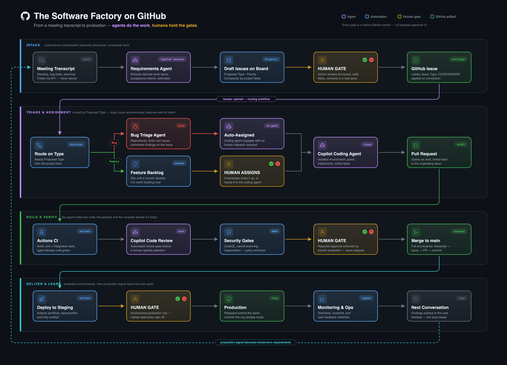

# Agentic Software Factory

Many signal streams, one contract. Work arrives from a meeting, a person, a
support ticket or a production alert, and every one of those paths produces
the same artifact. Nothing downstream ever learns where the work came from.

Agents do the work. Humans hold the gates. The human gate never disappears; it
moves, depending on how much you trust the source.

This repository is a template. Create your own copy, run one setup workflow,
add two tokens, and your repository can turn a meeting transcript into triaged
issues, hand bugs to the Copilot coding agent, and keep features waiting for a
human decision.

## The shape

<p align="center">
  
</p>

*The illustration shows the broader concept. This template uses locally supplied
transcripts and stops at merge; deployment and operations are outside its scope.*

1. **Intake.** In a Copilot session, the `meeting-intake` skill reads a
   transcript you supply and writes draft items to your project board, each with
   a body, possible duplicates, and `Proposed Type`, `Priority` and
   `Complexity` fields.
2. **Human gate.** You review each draft, fix its fields, and click
   **Convert to issue**. Nothing reaches the repository without that click.
3. **Enrichment.** The `issue-enrichment` agentic workflow runs on every new
   issue. It ignores issues the factory did not produce, and for the ones it
   did, applies labels and a real issue type from the board fields.
4. **Routing.** Bugs are assigned to the Copilot coding agent straight away.
   Features and chores get `needs-assignment` and wait in a priority-ordered
   board view until a person assigns Copilot.
5. **Merge.** Copilot opens a pull request. CI, Copilot code review, CodeQL and
   secret scanning run, and a person approves and merges.

The design decisions behind this are in [docs/ARCHITECTURE.md](docs/ARCHITECTURE.md).

## What you need

- A repository owned by a GitHub **organization**. Projects, issue types and
  the board link are organization features.
- GitHub Copilot Business or Enterprise for that organization, with the
  **Copilot coding agent** enabled for the repository.
- An organization owner for one-time setup, because setup creates a project and
  organization issue types.
- To run intake: a Copilot session that can use skills in this repository, and
  the [GitHub CLI](https://cli.github.com/) signed in with the `project` scope.
- To change the agentic workflow:
  [GitHub Agentic Workflows](https://github.github.com/gh-aw/) (`gh aw`).

## Quick start

1. Click **Use this template** and create the repository in your organization.
2. Create a short-lived setup token, store it as the `ASF_BOOTSTRAP_TOKEN`
   secret of a `factory-bootstrap` environment, and run the **Factory setup**
   workflow. It creates the labels, the project board with its fields and view,
   the issue types, a `factory` environment, a default-branch ruleset and
   security features, then commits the project number to
   `.github/factory/config.json`.
3. Create two long-lived tokens and store them as the
   `GH_AW_READ_PROJECT_TOKEN` and `GH_AW_AGENT_TOKEN` secrets of the `factory`
   environment, which only the default branch can use.
4. Edit [`.github/CODEOWNERS`](.github/CODEOWNERS) and
   [`AGENTS.md`](AGENTS.md) for your code and teams.
5. Run the **Factory doctor** workflow until every check passes, then delete
   `ASF_BOOTSTRAP_TOKEN` and revoke the token.

[docs/SETUP.md](docs/SETUP.md) walks through each step, including the exact
token permissions and how to run setup from your machine instead.

> Until setup is finished, `issue-enrichment` fails on every new issue with a
> message naming what is missing. That is deliberate: it fails loudly rather
> than skipping silently.

## Using it

**Turn a meeting into drafts.** Open a Copilot session in your clone of this
repository and ask it to run intake, for example *"use meeting-intake on
`~/Downloads/standup.vtt`"*. Teams, Zoom and Google Meet transcript exports
work. The transcript stays on your machine; it is never committed. The skill
reports what it created and what it deliberately left out.

**Review and convert.** Open the project board. For each draft, read the body
and acceptance criteria, check `Possible duplicates`, and correct
`Proposed Type`, `Priority` and `Complexity`. `Proposed Type` decides whether a
coding agent is assigned, so this is the decision that matters. Then use
**Convert to issue** and pick this repository.

**Watch it route.** A Bug gets `type:bug`, `agent-triaged`, a priority label,
the issue type Bug and a routing comment, and Copilot is assigned. Check the
issue's **Assignees**; the comment alone does not prove assignment. A Feature or
Chore gets `needs-assignment` and stops.

**Staff the backlog.** Open the board's **Needs assignment** view, open an
issue, and assign **Copilot**. That is the whole staffing gesture.

**Hand-written issues are left alone.** Open an issue by hand and nothing
happens: enrichment finds no intake marker and exits.

**Trace a change.** `node .github/factory/scripts/verify-provenance.mjs <commit-sha>`
walks a commit back to its pull request, issue and original source, or names
the hop that broke.

## Repository layout

```
.github/
  agents/requirements-agent.md   source material -> work items, precision over recall
  skills/
    meeting-intake/              transcript -> draft items, runs in your session
    intake-guardrails/           the one guarded write path every adapter shares
  workflows/
    issue-enrichment.md          agentic workflow source: check marker, enrich, route
    issue-enrichment.lock.yml    generated by `gh aw compile`; do not edit
    factory-setup.yml            provisions labels, board, issue types, ruleset
    factory-doctor.yml           checks the whole setup and reports what is wrong
    factory-ci.yml               builds and tests the factory tooling
  factory/
    config.json                  which project board this repository uses
    labels.json                  labels setup creates and enrichment may apply
    asf-spec-marker.txt          the only copy of the intake marker
    lib/, scripts/, test/        setup, doctor, validators and their tests
  CODEOWNERS                     commented examples; add your teams
AGENTS.md                        build and test instructions for coding agents
docs/                            overview diagram, setup guide and architecture
```

## Changing the factory

The tooling has no runtime dependencies beyond Node.js 20+ and the GitHub CLI.
Its tests use Vitest:

```bash
cd .github/factory
npm ci
npm run build
npm test
```

After editing `issue-enrichment.md`, run `gh aw compile` and commit the
regenerated `.lock.yml`. Lock files are committed on purpose: what actually runs
stays reviewable in a diff, and `gh aw compile` refuses to add a new secret
reference without `--approve`.

## License

[MIT](LICENSE)
